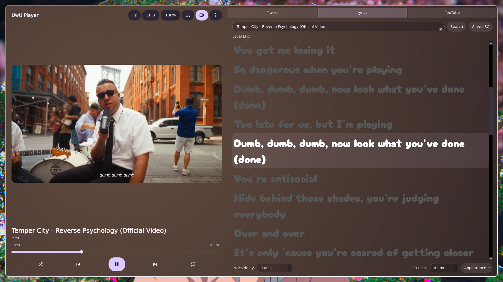

Chat make this repo supoort nixos 

https://github.com/DirmdsLab/waguri-mpv

bruh :v



# Waguri MPV untuk NixOS

Ekstrak ZIP ke direktori baru di luar checkout Git. Dari direktori itu, jalankan:

```bash
nix develop
nix run .
```

Flake mengambil source mpv pada commit `bb4823e5` dan libplacebo pada tag `v7.387.0`. `nix develop` menyiapkan lingkungan pengembangan. Saat pertama dijalankan, `nix run .` membangun GUI dan CLI mpv dari source yang sama, lalu membuka GUI di desktop. Jalankan dari host NixOS agar aplikasi memakai audio dan driver grafis sesi desktop. Build dan runtime dikelola oleh Nix tanpa impor cache manual.

Jika perintah flake belum aktif, tambahkan `experimental-features = nix-command flakes` ke konfigurasi Nix pengguna atau tambahkan flag `--extra-experimental-features 'nix-command flakes'` pada perintah `nix`.

```bash
nix run . -- "/path/to/video.mp4"
nix run .#mpv -- --no-config "/path/to/video.mp4"
```

Sistem yang tersedia adalah `x86_64-linux` dan `aarch64-linux`. GUI membawa pengaturan bawaan pemain. Patch Android opsional ada di `waguri/android/stop-replay.patch`.

Qt memakai EGL/OpenGL jika tersedia. Jika konteks gagal dibuat, Waguri menggunakan renderer CPU. Untuk memilihnya sejak aplikasi dibuka, jalankan `WAGURI_SOFTWARE_RENDER=1 nix run .`.

Thumbnail di tab Tracks dimuat saat baris terlihat. Waguri memakai cover, frame video, atau ikon jenis media jika file tidak menyediakan gambar.

Untuk memilih perangkat suara, buka **Player options → Audio output**. Pilihan **System default** mencoba PulseAudio, PipeWire, lalu ALSA. Pilih **Detected devices** jika suara perlu diarahkan ke perangkat tertentu. Untuk menimpa pilihan saat mulai, gunakan `WAGURI_AUDIO_DEVICE=pipewire/ nix run .` atau ganti `pipewire/` dengan `pulse/`.

Di tab **Lyrics**, ubah **Text size** dari 14 sampai 42 px atau gunakan **Ctrl + scroll** di area lirik. Ukuran awal 22 px. Pilihan ukuran disimpan.

Di **Lyrics → Appearance**, pilih font, warna teks, atau warna baris aktif. Pengaturan tersimpan dan bisa dikembalikan dengan **Reset appearance**.

Waguri menyediakan fallback Noto Sans CJK untuk judul dan lirik Jepang, Korea, dan Mandarin. Nix mengambil font ini otomatis.

Saat **Ambient light** aktif, warna artwork atau frame video bertransisi ke latar Tracks, Lyrics, dan YouTube. **Ambient light reach** mengatur seberapa jauh warnanya menyebar.
